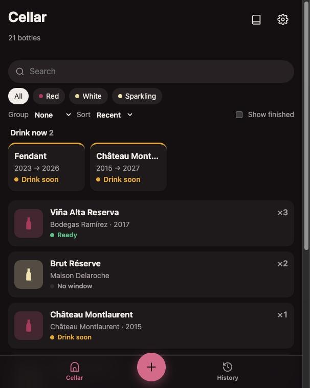
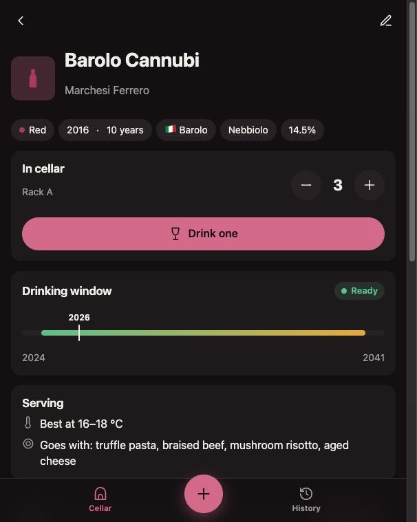
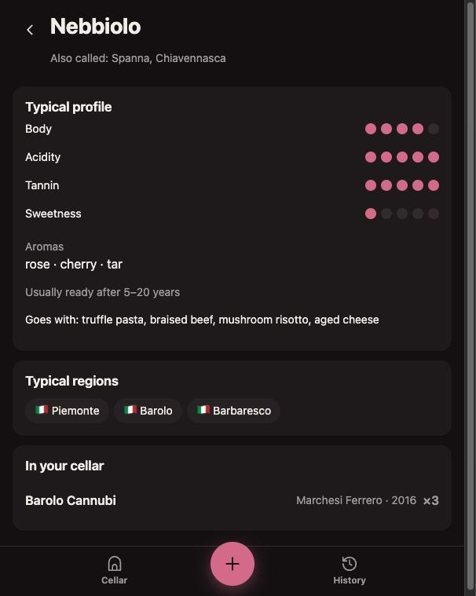
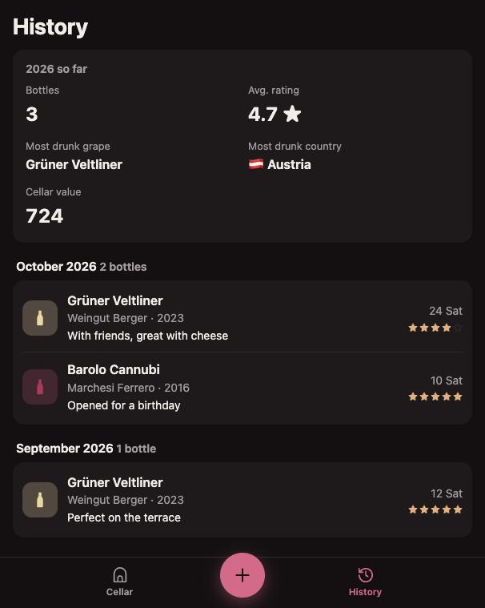

<p align="center">
  
</p>

<h1 align="center">Vintry</h1>

<p align="center">
  A slim, private wine cellar for your phone.<br>
  Scan a label, keep your bottles, log what you drank.
</p>

<p align="center">
  <a href="https://github.com/janfuhrer/Vintry/actions/workflows/ci.yml"></a>
  <a href="https://scorecard.dev/viewer/?uri=github.com/janfuhrer/Vintry"></a>
  <a href="LICENSE"></a>
</p>

<p align="center">
  
  
  
  
</p>

---

## Features

- **Scan a label.** Text recognition runs on your device (tesseract.js). No photo leaves your phone for a cloud service.
- **Smart defaults.** A built-in table of about 80 grapes and 110 regions suggests the drinking window and taste profile. You can override everything.
- **Drinking window at a glance.** Wait, ready, drink soon or past peak, with a bar that shows where this year sits.
- **Drink log.** "Drink one" takes a bottle out of the cellar and records the date, your rating and a note.
- **Private by design.** Every person has their own cellar. Sign-in is by passkey only, and new accounts come from invite links.
- **Your data stays yours.** Export the cellar and history as CSV or JSON, import an existing spreadsheet or a Vivino export, delete your account any time.
- **Installable PWA.** Works like an app on iOS and Android, in English and German. The cellar stays readable without signal, from a copy kept on your phone.
- **Self-contained.** No external requests at all: no CDN, no web fonts, no analytics.

## Quick start (development)

Requirements: Node.js 22.17 or newer and PostgreSQL 14 or newer.

```sh
git clone https://github.com/janfuhrer/Vintry.git
cd Vintry
npm ci
export DATABASE_URL=postgres://vintry@localhost:5432/vintry
npm run dev
```

On first start, with an empty database, the server logs a one-time admin invite:

```
[vintry] No users yet. Open this link within 24 h to create the admin account:
http://localhost:5173/invite/…
```

Open it, choose a name and create a passkey. From then on, invite people from **Settings**.

Passkeys work on `localhost` over plain HTTP. Any other host needs HTTPS.

## Configuration

| Variable          | Required          | Description                                                                                                                                                                         |
| ----------------- | ----------------- | ----------------------------------------------------------------------------------------------------------------------------------------------------------------------------------- |
| `DATABASE_URL`    | yes               | PostgreSQL connection string. The schema is migrated on start.                                                                                                                      |
| `APP_URL`         | yes in production | Public origin, e.g. `https://vintry.example.com`. Passkeys are bound to its host name, so changing it later makes existing passkeys stop working. Default: `http://localhost:5173`. |
| `BODY_SIZE_LIMIT` | no                | Maximum request size. Photos need about `2M` (the Docker image sets this).                                                                                                          |
| `PORT`            | no                | Listening port of the production server. Default: `3000`.                                                                                                                           |

The production server is the SvelteKit Node adapter. Behind a reverse proxy it uses the `Host` header and assumes HTTPS. See the [adapter-node docs](https://svelte.dev/docs/kit/adapter-node) for `PROTOCOL_HEADER`, `HOST_HEADER` and `ADDRESS_HEADER`.

## Lost passkeys

- **Someone else lost their phone:** an admin opens Settings → People → _Device link_ and passes
  the one-time link on. Opened on the new device, it adds a passkey to that person's account.
- **The only admin lost every passkey:** set `RECOVERY_USER=<name>` and restart. The server logs a
  one-time device link for that user, like the first-start invite. Remove the variable afterwards.

## Deployment

The `Dockerfile` builds a small production image that runs as a non-root user on port 3000:

```sh
docker build -t vintry .
docker run -p 3000:3000 \
  -e DATABASE_URL=postgres://user:pass@db/vintry \
  -e APP_URL=https://vintry.example.com \
  vintry
```

Put it behind a TLS-terminating proxy. Photos are stored in PostgreSQL, so backing up the database backs up everything.

## Development

| Command            | What it does                                                    |
| ------------------ | --------------------------------------------------------------- |
| `npm run dev`      | Dev server with hot reload                                      |
| `npm run check`    | Type-check Svelte and TypeScript                                |
| `npm run lint`     | Prettier and ESLint (`npm run format` fixes formatting)         |
| `npm test`         | Unit tests (Vitest): label parsing, wine logic, form validation |
| `npm run test:e2e` | End-to-end tests against the production build, see below        |
| `npm run test:ocr` | Real OCR on rendered sample labels, checks what a scan fills in |
| `npm run build`    | Production build into `build/`                                  |
| `npm run icons`    | Re-render the PNG app icons from `static/logo.svg`              |

The end-to-end suite starts the production build against a **throwaway** PostgreSQL
database, which it wipes first, and drives sign-up, login, wines, drinks and invites with a
software passkey:

```sh
createdb vintry_e2e
npm run build
E2E_DATABASE_URL=postgres://localhost/vintry_e2e npm run test:e2e
```

The OCR engine and language data are copied from `node_modules` to `static/ocr/` before `dev` and `build`. They are not committed.

See [docs/architecture.md](docs/architecture.md) for how the pieces fit together, and [CONTRIBUTING.md](CONTRIBUTING.md) before opening a pull request.

## Security

Please report vulnerabilities privately. See [SECURITY.md](SECURITY.md).

## License

Vintry is free software, licensed under the [GNU Affero General Public License v3.0 or later](LICENSE). If you run a modified version for others over a network, you must offer them its source code.
